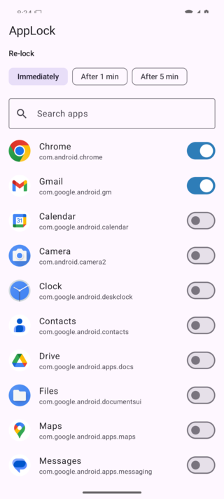
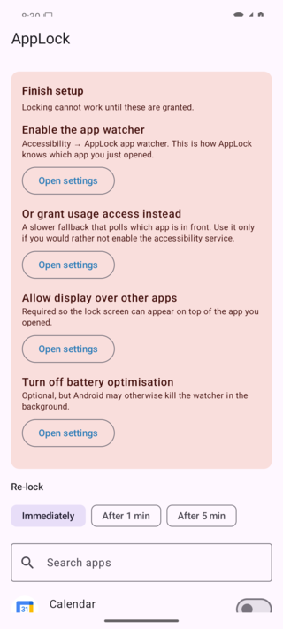
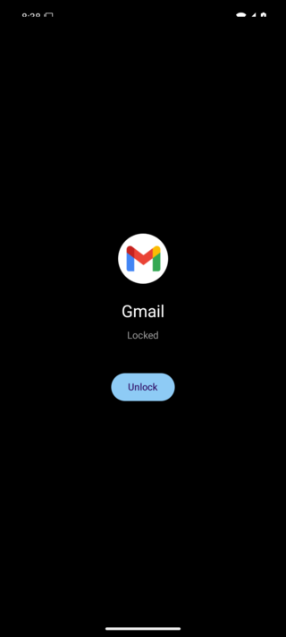

# AppLock

[](https://github.com/mimbasher/app-lock/actions/workflows/build.yml)

Per-app lock for Android. Pick any installed app; the next time it comes to the
foreground, a full-screen gate asks for your fingerprint, face, or the phone's own
PIN/pattern/password before the app is revealed.

Kotlin + Jetpack Compose, no third-party services, nothing leaves the device.

If AppLock is useful to you, a ⭐ helps other people find it.

| Pick what to lock | Finish setup | The gate |
|---|---|---|
|  |  |  |
| Locked apps float to the top. | Only missing grants are listed. | Shown the instant a locked app opens. |

The gate normally raises the system biometric prompt over itself immediately. It
is absent above because the real build sets `FLAG_SECURE`, and both it and the
system prompt refuse to be screenshotted — so these were taken from a temporary
build with that flag and the auto-prompt removed.

## How it works

Android has no "lock this app" API, so this does what every app locker does:

1. **Watch** which package just came to the foreground.
2. **Cover** it with our own activity the instant a locked package appears.
3. **Authenticate** via the system biometric prompt. Pass → the gate finishes and the
   app is there. Back/cancel → the user is sent to the home screen.

The app is never actually blocked; the gate just lands on top of it faster than the
user can interact with it.

### Two watchers

| | `AppWatchService` (primary) | `LockGuardService` (fallback mode) |
|---|---|---|
| Mechanism | `AccessibilityService`, `TYPE_WINDOW_STATE_CHANGED` events | Polls `UsageStatsManager` every 300 ms |
| Latency | Effectively instant | 200–700 ms — the app flashes into view first |
| Battery | Negligible, event-driven | Noticeable; needs a foreground-service notification |
| Grant | Settings → Accessibility | Settings → Special access → Usage access |

The accessibility route is strongly preferred. Polling exists for users who would
rather not enable an accessibility service, and as the takeover path when the
accessibility service dies.

### Staying alive

An accessibility service alone is not enough: when Android, an OEM battery manager or
a recents swipe kills the process, nothing re-arms the watcher and every locked app
opens freely until AppLock is launched again.

`LockGuardService` exists to close that. It runs as a foreground service whenever
anything is locked, which keeps the process — and the accessibility service living in
it — near the back of the queue when Android reclaims memory. On a 5-second heartbeat
it checks whether a watcher is genuinely live, falls back to polling if the
accessibility service has gone away (including when its toggle still reads "on" but
Android never re-bound it), and names the mode actually in force in its notification.
`WatchdogJob`, a persisted periodic job, restarts the guard if the process is killed
anyway. When nothing is protecting anything, a high-priority notification and a card
on the home screen say so, rather than failing silently.

None of this survives a **force stop**: that cancels our jobs along with everything
else, and no unprivileged app can schedule its way out of it. Reaching the force-stop
button means reaching Settings, so locking Settings itself is the only defence AppLock
can offer there.

The accessibility service declares `canRetrieveWindowContent="false"` — the package
name arrives on the event itself, so the app never reads screen contents.

### Why window events get filtered

`TYPE_WINDOW_STATE_CHANGED` fires for keyboards, toasts, the status bar and system
popups, not just app switches. Treating those as "the user left the app" would spend
the unlock and re-prompt constantly. `AppWatchService` therefore ignores any package
that does not own a launcher icon.

## Source map

```
app/src/main/java/com/turboo/applock/
├── AppLockApplication.kt        Application + repository singleton; caches the theme for the gate
├── Permissions.kt               Every special permission, and the Settings screen that grants it
├── data/
│   ├── LockRepository.kt        DataStore: locked packages, re-lock delay, theme, self-lock
│   ├── SessionGate.kt           In-memory "already authenticated" state (never persisted)
│   ├── InstalledApps.kt         Launchable-app list + icons for the picker
│   └── ThemeMode.kt             System / Light / Dark
├── service/
│   ├── AppWatchService.kt       AccessibilityService watcher
│   ├── LockGuardService.kt      Keeps the process resident; polls if the watcher dies
│   └── WatchdogJob.kt           Persisted job that restarts the guard after a kill
├── receiver/BootReceiver.kt     Starts the guard after a reboot
├── update/AvailableUpdate.kt    A release newer than the installed one; shared by both flavours
└── ui/
    ├── MainActivity.kt          Compose host: onboarding/home/settings, and the self-lock gate
    ├── AppListViewModel.kt      App list, search, filter, update state
    ├── OnboardingScreen.kt      First-run screen for the grants the app cannot work without
    ├── HomeScreen.kt            Update banner, search, filter chips, the app list
    ├── SettingsScreen.kt        Re-lock delay, theme, lock-AppLock-itself, version
    ├── UpdateBanner.kt          Silent until there is something to say
    ├── LockScreenActivity.kt    The gate; FragmentActivity (BiometricPrompt requires it)
    ├── LockScreen.kt            Gate UI
    ├── BiometricAuth.kt         Shared system-prompt helper, including the API 28–29 quirk
    └── theme/Theme.kt           Light/dark schemes, Material You where the device has it
```

The two flavours ([below](#two-flavours)) add one package each, implementing
the same `update` API:

```
app/src/github/                  Sideload build: the real updater
├── AndroidManifest.xml          INTERNET, REQUEST_INSTALL_PACKAGES, the installer FileProvider
├── java/…/update/UpdateChecker.kt    Latest GitHub release, compared a version component at a time
├── java/…/update/UpdateInstaller.kt  Downloads the APK, hands it to the system installer
└── res/xml/update_paths.xml     The one cache directory the FileProvider may share

app/src/play/                    Play build: the same API, inert
└── java/…/update/               UpdateChecker returns null; UpdateInstaller does nothing
```

### Theme

**System**, **Light** or **Dark**, chosen in the app and stored with the other
settings; **System** is the default and follows the device.

The choice also applies to the gate, which has to colour itself the instant it
is created. A suspending read there would flash the wrong scheme over the app
being covered, so `AppLockApplication` keeps the last value in
`LockRepository.cachedThemeMode` for the life of the process and the gate reads
that synchronously.

### Session rules

`SessionGate` holds unlocks in memory only — a reboot or process death means everything
is locked again. An unlock ends when:

- the screen turns off, or
- the user leaves the app (when re-lock is set to *Immediately*), or
- the configured delay elapses (1 or 5 minutes).

## Build

Requires the Android SDK and **JDK 21** — AGP does not run on JDK 26, so
`gradle.properties` pins `org.gradle.java.home` to `/usr/lib/jvm/java-21-openjdk`.
Change that line if your JDK lives elsewhere.

```sh
./gradlew assembleGithubDebug
adb install -r app/build/outputs/apk/github/debug/app-github-debug.apk
```

### Two flavours

| | `github` (default) | `play` |
|---|---|---|
| Shipped as | APK on the Releases page | App Bundle on Google Play |
| Self-updater | Checks GitHub, downloads, offers to install | Absent |
| `INTERNET` | Declared | Not declared — no network access at all |
| `REQUEST_INSTALL_PACKAGES` | Declared | Not declared |

Google Play forbids an app that downloads and installs its own APK, so the
updater cannot ship in a Play build. Both flavours compile against the same
`update` API: `src/play` supplies stubs whose `check()` returns null, which
leaves the banner and the launch check inert, and the permissions and
`FileProvider` the real updater needs are declared only in
`src/github/AndroidManifest.xml`. So the Play build contains no update code at
all, rather than update code that is switched off.

### CI

`.github/workflows/build.yml` lints both flavours and builds the `github` APK on
every push to `main`, on pull requests, and on demand via **Actions → Build APK
→ Run workflow**. The APK lands as the `applock-v<run number>` artifact on the
run page, with the lint report beside it. When the signing secrets below exist,
a signed Play bundle is built too and lands in the same artifact.

The runner strips the `org.gradle.java.home` line from `gradle.properties`
first, since that path is local to a developer machine.

### Releases

Every push to `main` publishes a GitHub Release by itself — `build.yml` creates
the tag `v1.<run number>` and attaches the APK, giving a permanent public
download link (Actions artifacts expire and need a login; release assets do
not). There is no tag to push by hand, and `run_number` only ever increases, so
the version never goes backwards either.

Pull requests build and lint but publish nothing.

Without a signing keystore it publishes the **debug-signed** APK. That installs
fine for sideloading, but it is debuggable, and a later signed release cannot
upgrade it in place — Android refuses an update signed by a different key, so
users would have to uninstall first.

To publish properly signed builds, create a keystore and add four repository
secrets:

```sh
keytool -genkey -v -keystore applock.jks -alias applock \
  -keyalg RSA -keysize 2048 -validity 10000
base64 -w0 applock.jks          # paste as KEYSTORE_BASE64
```

| Secret | Value |
|---|---|
| `KEYSTORE_BASE64` | the base64 above |
| `KEYSTORE_PASSWORD` | keystore password |
| `KEY_ALIAS` | `applock` |
| `KEY_PASSWORD` | key password |

Keep `applock.jks` safe and out of the repo; losing it means never being able
to update an installed copy again.

## First-run setup

The app shows a checklist for whatever is missing:

1. **Accessibility → AppLock app watcher** — how the app knows what you opened.
2. **Display over other apps** — required, or Android 10+ blocks the gate from
   launching from the background.
3. **Battery optimisation off** — optional, but Android may otherwise kill the watcher.

The home screen also recommends locking the Settings app once, dismissibly. Force
stop, the accessibility toggle and uninstall all live in Settings, so locking it means
each of those needs authentication first — the closest an unprivileged app gets to
tamper protection.

## Known limits

These are inherent to doing this without system privileges:

- A user can disable the accessibility service in Settings, force stop the app, or
  uninstall it. Blocking that needs Device Admin, which is heavily restricted. Locking
  the Settings app raises the bar, since all three routes go through it.
- Aggressive OEM task-killers (Xiaomi, Oppo, Huawei, Samsung) kill background
  services; `LockGuardService` and `WatchdogJob` recover from that within a job tick,
  but those devices still want manual whitelisting to avoid the gap entirely.
- There is a brief window where the locked app is visible before the gate lands —
  short with the accessibility watcher, clearly visible with the poller.
- If no biometric is enrolled *and* no screen lock is set, the gate opens rather than
  refusing, since there would be nothing to check against.
- Recents-screen previews of locked apps are not suppressed; only the gate itself sets
  `FLAG_SECURE`.

## In progress

- Redesigned UI — settings screen, onboarding, filters, Material You
- Getting the `play` flavour onto Google Play

## Planned features 🚧

- AppLock's own PIN, separate from the phone's
- Intruder photo after failed attempts
- Auto-lock newly installed apps
- Hide locked apps from the recents switcher
- Quick Settings tile to pause locking
- Per-app re-lock delay
- Backup and restore the locked list
- Uninstall protection (Device Admin)

## Open risks

Unresolved, as opposed to the inherent limits above:

- v1.0 is debug-signed, so a properly signed build cannot upgrade it in place
  (see [Releases](#releases)).
- The fingerprint path has never run on real hardware — only the emulator's PIN.
- OEM task-killers may stop the watcher; untested.
- CI versions are `1.<run_number>`, so a counter reset would send versions
  backward.

## Contribution & Support

All pull requests, feedback and contributions are welcome! Please read the
[Contributing guidelines](CONTRIBUTING.md) for more about how to contribute and
how to build and run the project.

The most useful contribution needs no code at all: a **real-device report**.
The fingerprint path has only ever run against an emulator's PIN, and OEM
background-killing is untested — if you run AppLock on a real phone,
especially a Xiaomi, Oppo, Huawei or Samsung,
[open a device report](https://github.com/mimbasher/app-lock/issues/new?template=device-report.yml)
saying what it did.

If AppLock is useful to you, a ⭐ helps other people find it.

## Publishing to Play

The `play` flavour above is the build that may be uploaded; the rest is Console
work. None of this matters for sideloading.

1. **Developer account.** $25 once, plus identity verification. A *personal*
   account created after 13 November 2023 has to run a closed test with **12
   testers opted in continuously for 14 days** before production access
   unlocks — and if the count drops below 12, the 14 days start again.
   Organisation accounts skip this but need a D-U-N-S number.
2. **Upload a bundle, not an APK.** `./gradlew bundlePlayRelease`, signed, with
   Play App Signing; CI builds exactly this when the keystore secrets exist.
   Every upload needs a `versionCode` higher than the last one Play has seen.
3. **Declarations.** The accessibility service needs a permissions declaration
   *and* a prominent in-app disclosure of what it does; `QUERY_ALL_PACKAGES`
   needs its own declaration; `FOREGROUND_SERVICE_SPECIAL_USE` needs a
   justification. App-locking is an accepted use of all three, but accessibility
   is where app lockers actually get rejected, so be explicit rather than
   minimal.
4. **Privacy policy and Data safety.**
   [docs/privacy-policy.md](docs/privacy-policy.md) is the policy; Play wants it
   at a public URL, which GitHub Pages will serve from `docs/`. The Data safety
   form has to agree with it: nothing collected, nothing shared, no network
   access in this flavour.
5. **Listing.** 512×512 icon, 1024×500 feature graphic, at least two phone
   screenshots, short and full descriptions, content rating questionnaire. The
   gate sets `FLAG_SECURE`, so screenshotting it needs a temporary build with
   that flag removed — the same trick as the screenshots at the top of this
   file.
6. **`targetSdk`.** 36, as required of new apps since 31 August 2026 and already
   set here. Android 16 also stops apps on screens 600dp and wider locking
   orientation or opting out of edge-to-edge, which is worth checking on a
   tablet before upload.

One decision to make before the first upload: both flavours use the application
ID `com.turboo.applock`, so a phone holding the sideloaded build cannot install
the Play build over it, or the reverse — different signing keys. Giving `play`
its own ID avoids that, at the price of them being two separate apps.
